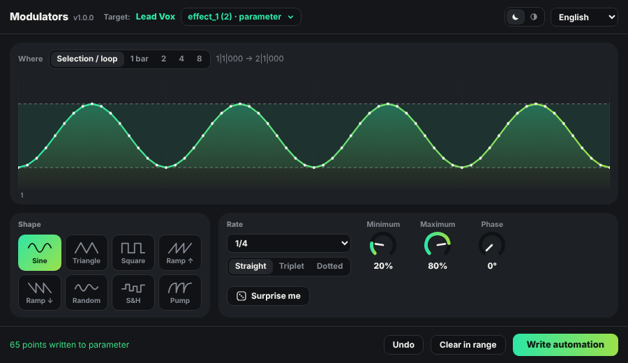
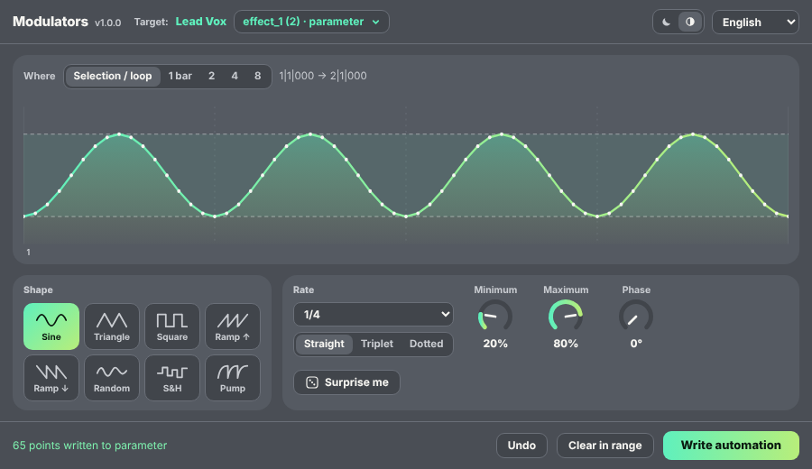

# Modulators for LUNA

Tempo-synced movement for anything in LUNA. Sine, ramp, S&H, pump and more on volume, pan, sends
or any plug-in or instrument parameter, written as normal automation you can still edit. See the
curve over your bars before you write it.

  
  

## Features

- **Any parameter:** volume, pan, mute, sends, the track's instrument and every parameter of the
  plug-ins on its inserts. Stereo tracks can move the pan keeping the width, or left and right on their own.
- **A list that stays tidy:** plug-ins fold into groups, there is a search box, and the list
  refreshes by itself when you add or remove plug-ins.
- **See what is already modulated:** parameters with automation stay at the top of the list,
  coloured by kind — violet for the mixer, blue for sends, green for plug-ins. The ones written
  by Modulators carry a wave icon, and each plug-in shows how many of its parameters move.
- **Eight shapes:** sine, triangle, square, ramp up, ramp down, random, S&H and pump.
- **Locked to the tempo:** rates from 4 bars to 1/32, straight, triplet or dotted.
- **Range and phase:** set the minimum and maximum the parameter travels between and where the
  cycle starts; **Surprise me** rolls a new combination.
- **Where to write:** the selection or loop, or 1, 2, 4 or 8 bars from the cursor.
- **Preview first:** the curve is drawn over the bars and beats, with the existing automation
  drawn faintly behind it so you can compare before writing.
- **Clean steps** for mute and stepped plug-in parameters.
- **Clear in range** and **Undo**.
- **Dark and grey themes.**
- **7 languages:** English, Español, Català, Français, Deutsch, Italiano and Português.

## How to use it

1. In LUNA, select a track and, if you like, a range or a loop.
2. In **Modulators**, pick the parameter, the shape, the rate and the range.
3. Press **Write automation**. The track is set to read automation so you hear it straight away.

The first time it opens, it asks for your language and then a short guide walks you through the
window in it; the **Guide** button brings it back whenever you need it.

## Support

If something does not work as expected, Alt-click the version number at the top of the window:
it copies a short report to paste in a message to fedetrillo@gmail.com.

## Install

Requires LUNA 3.1.2 or later. Install it from LUNA's Add On marketplace, or download
`modulators.lunaaddon` from the latest release and double-click it. Then open a session and
choose **Add Ons > Windows > Modulators**.

## En español

LFOs y formas sincronizados al tempo para LUNA. Elige un parámetro de la pista seleccionada
(volumen, panorama, mute, envíos, el instrumento o cualquier parámetro de los plugins de sus
inserciones), una
forma, una velocidad y un rango, y Modulators lo escribe como automatización en la selección, el
bucle o unos compases. Los parámetros ya modulados se ven arriba de la lista, con el color de su
categoría. Modo oscuro y gris, 7 idiomas.

## Licence

Copyright (c) 2026 Fede Trillo. All rights reserved. Free to install and use in LUNA; the code
may not be copied, modified or redistributed. See [LICENSE](LICENSE). The bundled LUNA Builder
SDK is Universal Audio's, under the Apache License 2.0: see
[THIRD_PARTY_NOTICES.md](THIRD_PARTY_NOTICES.md).

Contact: fedetrillo@gmail.com
